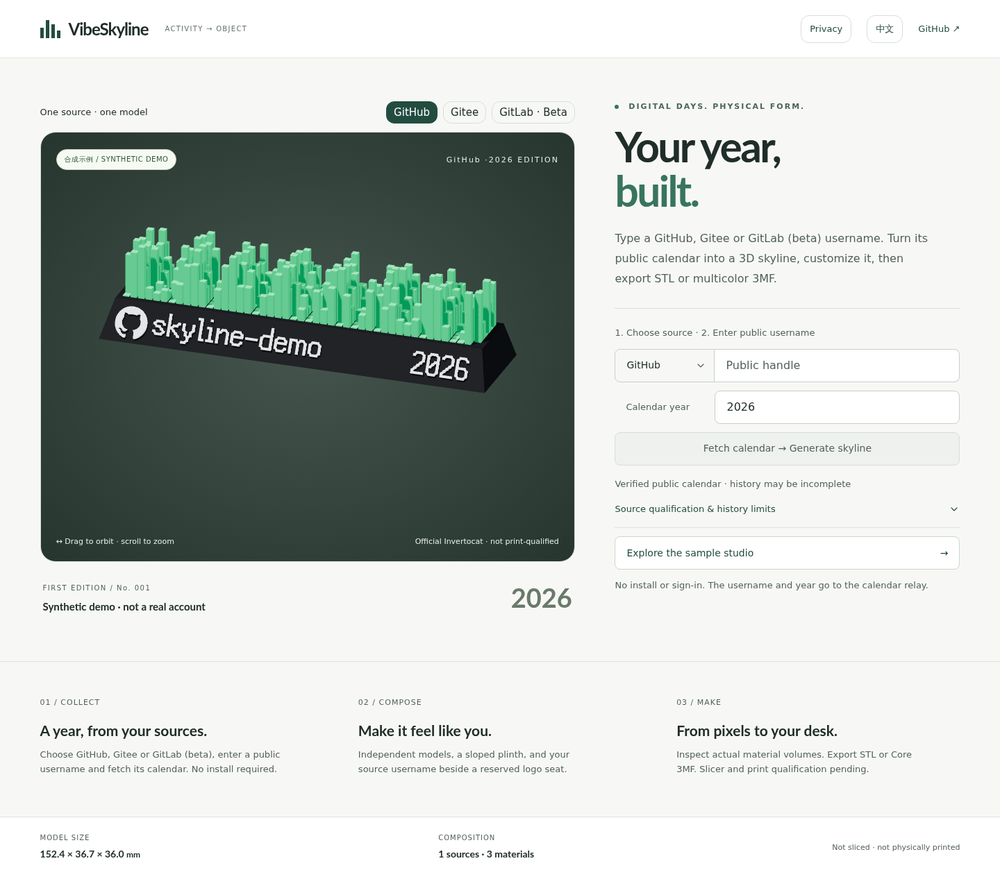

# VibeSkyline

**Your year, built. / 把这一年，筑成天际线。**

Live site: **[https://vibeskyline.com](https://vibeskyline.com)**

Public source: **[github.com/jinxlzc/vibe-skyline](https://github.com/jinxlzc/vibe-skyline)**

A zero-install website: **choose GitHub, Gitee or GitLab (beta) → enter a public username → fetch its public calendar → generate a 3D skyline → preview and customize colors and lettering → export STL or multicolor Core 3MF**. No login, token collector, or CLI required. Only code-hosting contribution calendars are supported; there is no AI-activity or token-file import.

输入 GitHub / Gitee / GitLab（Beta）公开用户名，获取贡献日历，生成并预览天际线，可选配色与刻字后导出。无需安装或登录。

The default visual is clearly labeled **SYNTHETIC DEMO**, not a signed-in account. Fetching a public calendar replaces the sample series. Default engraving uses the source username, never a legal name. The default font is **VibeSkyline Grid**. Unknown dates remain unknown; complete history is not promised.

**One source = one independent model.** Switch between source models; each has its own sloped plinth, logo seat, editable ID, and year. Downloads include the source name and contain only the selected source.

**一个来源，一个独立模型。** 可切换预览，每个模型独立刻字、预留标志位和年份，分别导出。

**Official GitHub Invertocat is the public default**, alongside Gitee’s official white mark, in the 12.5 mm front seat for preview, STL, and Core 3MF. No written redistribution or printable-derivative grant is claimed. Both remain **not print-qualified** (GitHub: ~0.957 mm stroke / ~0.538 mm gap). Other sources keep an empty plate. The Shape panel provides one-click per-source and global kill switches plus BYO SVG. See [trademark provenance](licenses/TRADEMARKS.md).

GitHub 默认显示官方 Invertocat，Gitee 默认显示官方白色标志。不声称获得再分发或打印衍生授权，亦不声称打印认证。形态页可一键关闭当前来源或全部官方标志，仍可自带 SVG。

[](examples/m5/README.md)

## Try the flow / 使用流程

1. Select GitHub (default), Gitee, or GitLab (beta); enter a public username and year.
2. **Fetch calendar → Generate skyline**. The public username and year go through the configured calendar relay.
3. Select a source model, optionally change Colors or Shape (ID, year, local SVG), then choose Export → STL / Core 3MF. Repeat for another source.
4. **Explore the sample studio** uses synthetic GitHub, Gitee, and GitLab beta calendars. It is not account evidence.

## Run locally / 本地运行

Node **≥22.15** and pnpm 10:

```sh
git clone https://github.com/jinxlzc/vibe-skyline.git
cd vibe-skyline
pnpm install --frozen-lockfile
pnpm dev                       # http://127.0.0.1:5173, integrated restricted relay
```

The relay rejects private and reserved addresses by default, including common fake-IP ranges. A trusted local preview can opt in at process start; see [calendar relay](docs/CALENDAR_RELAY.md). Do not put tokens in `VITE_*` variables or browser JS.

[中文快速开始](docs/QUICKSTART_zh.md) · [English quickstart](docs/QUICKSTART_en.md) · [Privacy](docs/PRIVACY.md)

## Production / 生产部署

One Node 22 process serves the built site and the `/api/calendar` relay. It listens on `PORT` (bound to `0.0.0.0`) and exposes `GET /healthz`.

```sh
pnpm build
NODE_ENV=production PORT=8080 RELAY_ORIGINS=https://vibeskyline.com,https://www.vibeskyline.com node apps/web/server/dist/index.mjs
```

Set `RELAY_ORIGINS` to the exact public `https://` origins (comma-separated, no trailing slash). A `Dockerfile` and [Railway notes](docs/RAILWAY.md) are included. Cross-border calendar fetches may be slow or fail; operators are responsible for their own hosting and any local filing requirements.

## Source status / 数据源状态

Status describes implementation qualification, not completeness of a user’s history.

| Source / method | Status | Evidence / limitation |
|---|---|---|
| GitHub public calendar | verified | Synthetic fixtures plus live smoke of the restricted relay |
| Gitee public calendar | verified | Synthetic fixtures and live paths; unofficial endpoint, can be intermittent |
| GitLab public calendar | **Beta / fixture-tested** | Synthetic fixtures only; official past-12-month window; no live qualification |

## Printing / 打印

STL and standard Core 3MF are printer-agnostic. Dimensions are in **mm**; each chosen color becomes a material group. There is no default printer, build-volume preset, or material-slot cap. Your slicer decides filament mapping. Mesh validation, stroke/gap limits, and mass/volume measurements remain enabled.

名称默认取当前所选来源主动提供的公开用户名；没有时使用 `skyline-demo` 并提示输入。不会从邮箱、路径、设备、会话或账号 ID 推断身份。公共示例不使用真实姓名。

The footer reports actual geometry bounds. Purge and print time remain **unknown until sliced**. **Not sliced; not physically printed.**

**VibeSkyline Grid** is the public default font: a generic CJK/Latin pixel font under SIL OFL 1.1. See [font research and licenses](docs/FONTS.md).

## Validate / 验证

```sh
pnpm typecheck
pnpm lint
pnpm test
pnpm build
pnpm test:e2e                   # compiled production server
```

[Security](SECURITY.md) · [Third-party notices](THIRD_PARTY_NOTICES.md) · [Design](docs/DESIGN.md)

## Trademarks / 商标

GitHub®, Invertocat, and Octocat® are trademarks of GitHub, Inc. VibeSkyline is independent and not affiliated with, endorsed by, or sponsored by GitHub or the other source vendors. Bundling official marks is not a license grant. [Full notice](licenses/TRADEMARKS.md).

**Kill switch:** Shape → **Use empty plate for this source** or **Disable official marks for all sources**. Operators can build with `VITE_OFFICIAL_LOGOS=off` or `VITE_DISABLED_OFFICIAL_LOGO_SOURCES=github,gitee`.

## License

[MIT](LICENSE). Copyright (c) 2026 jinxlzc.
